<div align="center">


<a href="https://github.com/BASIL-SAJI-MATHEW">

</a>

<br/>


<br/><br/>

<a href="https://www.altivorahosting.com"></a>
<a href="https://linkedin.com/in/basil-saji-mathew"></a>
<a href="https://www.instagram.com/basil_saji_mathew"></a>


</div>


## whoami

```bash
$ whoami
basil-saji-mathew

$ cat profile.json
{
  "role":      "Lua Developer and Backend Engineer",
  "company":   "Altivora Hosting (Founder & CEO)",
  "location":  "Bangalore, India",
  "focus":     ["API Development", "Automation", "Real-time Systems", "Security Monitoring"],
  "databases": ["MySQL", "PostgreSQL", "Redis"],
  "currently": "Building monitoring tools and backend services",
  "open_to":   "Backend Developer opportunities",
  "fun_fact":  "Ships FiveM scripts that idle at 0.00ms"
}
```


## How I build

The pattern behind most of my backend and automation work:

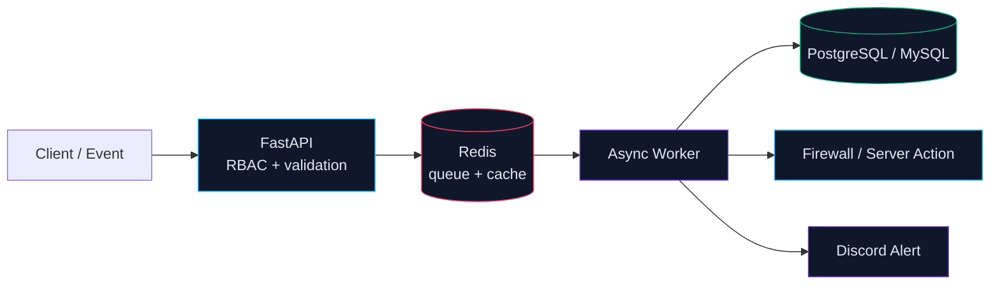


## Tech arsenal

<div align="center">

**Backend and languages**<br/>


**Data**<br/>


**DevOps and infrastructure**<br/>


**Frontend**<br/>


</div>

### Skill map

| Primary (daily use) | Working (comfortable) | Exploring (going deeper) |
|---|---|---|
| Lua (FiveM) | Node.js, TypeScript | System design at scale |
| MySQL, PostgreSQL | React, Next.js | Advanced Lua patterns |
| Linux, Docker | Redis | Observability and tracing |
| Automation, scripting | AWS, GitHub Actions | Detection engineering |
| Redis | Nginx, Cloudflare | Kubernetes |


## Featured projects

<div align="center">

<a href="https://github.com/BASIL-SAJI-MATHEW/portcullis">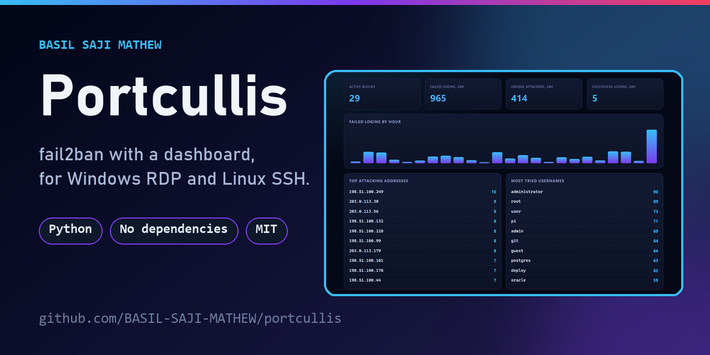</a>

**New: [Portcullis](https://github.com/BASIL-SAJI-MATHEW/portcullis)**, an open-source login-attack shield for Windows RDP and Linux SSH.
fail2ban with a dashboard. Python, no dependencies, MIT licence.

</div>


<table align="center">
<tr>
<td width="50%" valign="top">

### [IP Whitelist Automation](https://github.com/BASIL-SAJI-MATHEW/IP-Whitelist-Automation)

<a href="https://github.com/BASIL-SAJI-MATHEW/IP-Whitelist-Automation">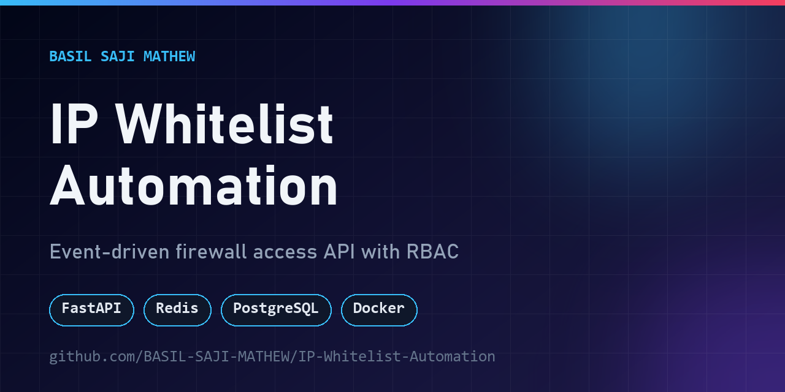</a>

Production-grade IP whitelisting with **RBAC**, async processing and time-based firewall rules.

`FastAPI` `Redis` `PostgreSQL` `Docker`

[](https://github.com/BASIL-SAJI-MATHEW/IP-Whitelist-Automation)  

</td>
<td width="50%" valign="top">

### [RDP Login Monitor](https://github.com/BASIL-SAJI-MATHEW/Rdp-Login-Monitor)

<a href="https://github.com/BASIL-SAJI-MATHEW/Rdp-Login-Monitor">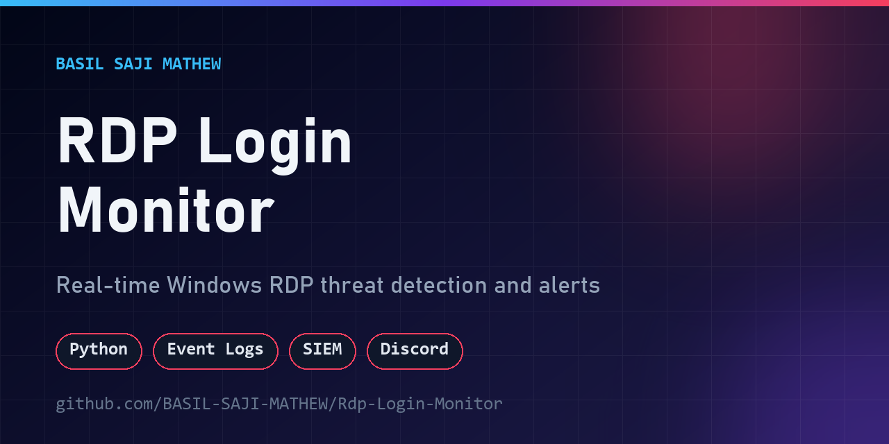</a>

Real-time detection and alerting of suspicious Remote Desktop logins via Windows Event Logs. Built for blue-team and SOC use.

`Python` `SIEM` `Discord Alerts`

[](https://github.com/BASIL-SAJI-MATHEW/Rdp-Login-Monitor)  

</td>
</tr>
<tr>
<td width="50%" valign="top">

### [Automatic SFTP Backup System](https://github.com/BASIL-SAJI-MATHEW/Automatic-SFTP-Backup-System)

<a href="https://github.com/BASIL-SAJI-MATHEW/Automatic-SFTP-Backup-System">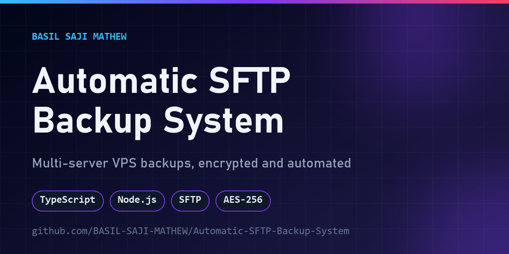</a>

Multi-server VPS backups with sync, encryption, compression, database dumps and Discord notifications.

`TypeScript` `Node.js` `SFTP` `DevOps`

[](https://github.com/BASIL-SAJI-MATHEW/Automatic-SFTP-Backup-System)  

</td>
<td width="50%" valign="top">

### [BSM Weapon Control](https://github.com/BASIL-SAJI-MATHEW/BSM_Weapon_Control)

<a href="https://github.com/BASIL-SAJI-MATHEW/BSM_Weapon_Control">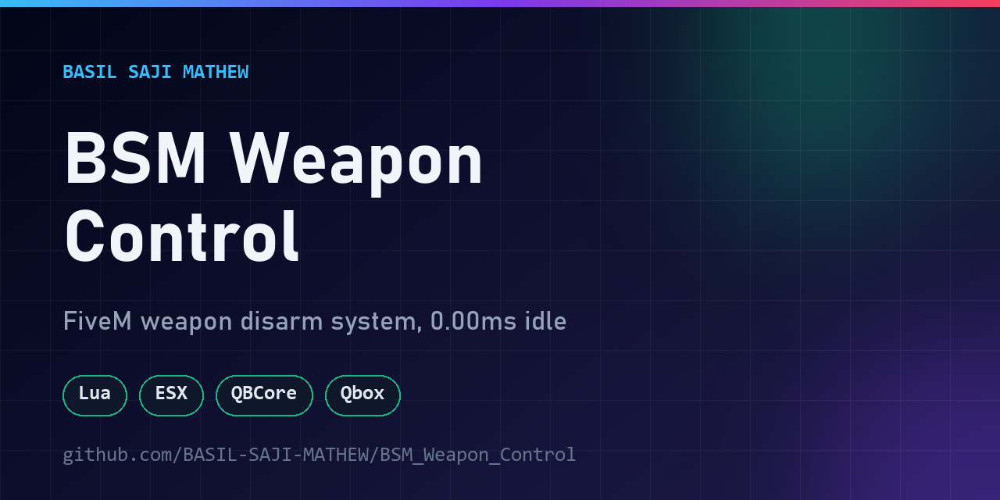</a>

FiveM weapon disarm system for ESX, QBCore, Qbox and Standalone. ox_inventory support, MySQL cooldowns, **0.00ms idle**.

`Lua` `oxmysql` `ox_lib`

[](https://github.com/BASIL-SAJI-MATHEW/BSM_Weapon_Control)  

</td>
</tr>
<tr>
<td colspan="2" align="center" valign="top">

### [FiveM Database Backup](https://github.com/BASIL-SAJI-MATHEW/fivem-database-backup)

<a href="https://github.com/BASIL-SAJI-MATHEW/fivem-database-backup">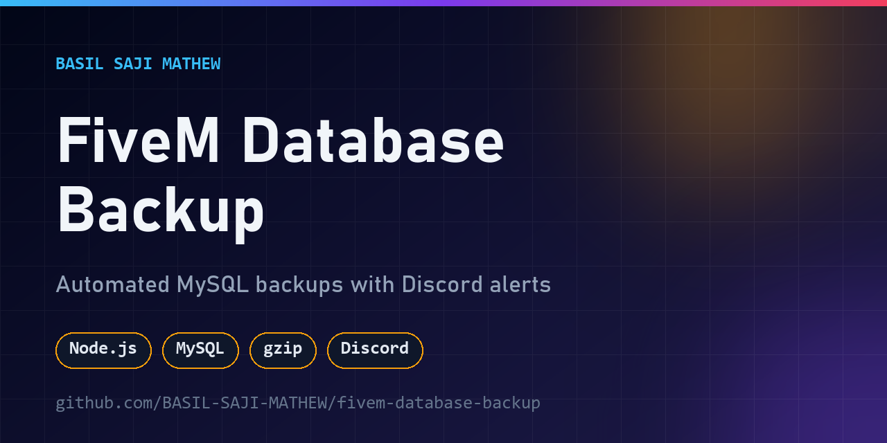</a>

Automated MySQL backups for FiveM servers with gzip, smart cleanup and Discord alerts.

</td>
</tr>
</table>

<details>
<summary><b>More about each project</b> (click to expand)</summary>
<br/>

| Project | Problem it solves | Key features | Stack |
|---|---|---|---|
| IP Whitelist Automation | Manual firewall changes are slow and risky | RBAC, async jobs, rules that expire automatically | FastAPI, Redis, PostgreSQL, Docker |
| RDP Login Monitor | Brute-force RDP attempts go unnoticed | Event log parsing, real-time alerts, threat analysis | Python, Windows Event Logs |
| SFTP Backup System | Multi-VPS backups are tedious and fragile | Sync, encryption, compression, DB dumps, alerts | TypeScript, Node.js |
| BSM Weapon Control | Server owners need a lightweight disarm system | Multi-framework, safe zones, admin tools | Lua, oxmysql |
| FiveM Database Backup | Game databases need reliable backups | gzip, retention cleanup, Discord alerts | Node.js, MySQL |

</details>


## What I can build for you

| Backend and APIs | Automation | Security tooling | Game servers |
|---|---|---|---|
| REST APIs with FastAPI | Backup and sync pipelines | Login and intrusion monitoring | FiveM scripts (ESX, QBCore, Qbox) |
| Auth, RBAC, async workers | Server and firewall workflows | Alerting to Discord | MySQL persistence |
| MySQL, PostgreSQL, Redis | Scheduled jobs and bots | Log analysis | Performance tuning |


## Live stats

<div align="center">

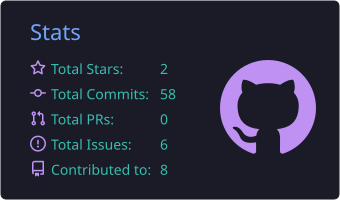
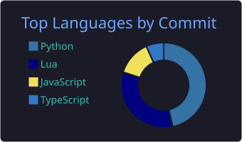
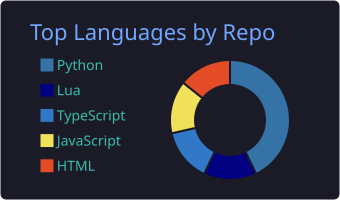
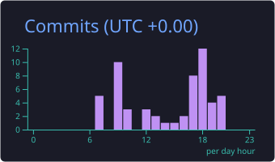


</div>


## Contribution snake

<div align="center">
<picture>
  <source media="(prefers-color-scheme: dark)" srcset="https://raw.githubusercontent.com/BASIL-SAJI-MATHEW/BASIL-SAJI-MATHEW/output/github-snake-dark.svg"/>
  <source media="(prefers-color-scheme: light)" srcset="https://raw.githubusercontent.com/BASIL-SAJI-MATHEW/BASIL-SAJI-MATHEW/output/github-snake.svg"/>
  
</picture>
</div>


## Currently

- Building real-time monitoring tools and backend services
- Going deeper into Lua, backend services and system design
- Open to **Backend Developer** roles, and to collaborating on automation and security tooling
- Running **[Altivora Hosting](https://www.altivorahosting.com)**: game server and VPS hosting

## Let's connect

If you're hiring for a backend role, need an automation or monitoring tool built, or want to talk hosting, email [hello@basilsajimathew.com](mailto:hello@basilsajimathew.com), reach out on [LinkedIn](https://linkedin.com/in/basil-saji-mathew) or through [Altivora Hosting](https://www.altivorahosting.com).

<div align="center">


</div>
